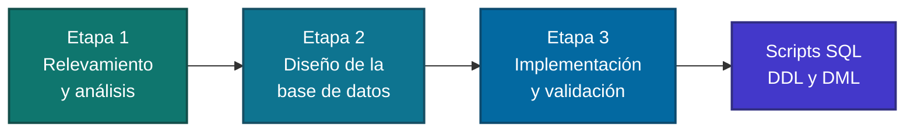
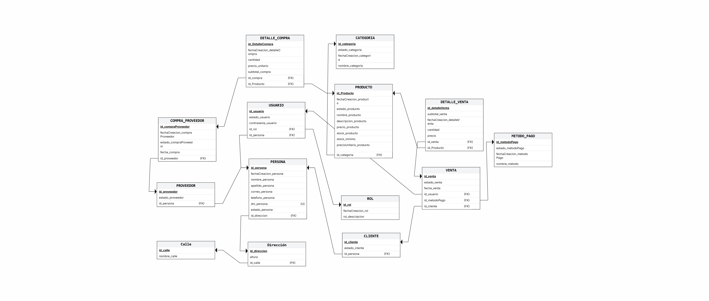

<a id="inicio"></a>

<div align="center">

# Pet Shop del Litoral

### Proyecto de Base de Datos | Equipo 11

Diseño e implementación de una base de datos relacional para un comercio de productos y servicios para mascotas.

<br>


<br>


<br>

[](#etapa-1-relevamiento-y-an%C3%A1lisis)
[](#etapa-2-dise%C3%B1o-de-la-base-de-datos)
[](#etapa-3-implementaci%C3%B3n-y-validaci%C3%B3n)
[](#scripts-sql)
[](#equipo)

</div>

<br>

---

## Sobre el proyecto

Este repositorio reúne el desarrollo completo de una base de datos para la empresa **Pet Shop del Litoral**, realizado en el marco de la materia **Base de Datos** de la carrera **Licenciatura en Sistemas de Información** de la **Universidad Nacional del Nordeste (UNNE)**.

El trabajo se organiza en tres etapas sucesivas, desde el relevamiento del caso hasta la implementación y validación del modelo en SQL.

<div align="center">

| | |
|:--|:--|
| **Empresa** | Pet Shop del Litoral |
| **Materia** | Base de Datos |
| **Carrera** | Licenciatura en Sistemas de Información |
| **Universidad** | Universidad Nacional del Nordeste (UNNE) |
| **Equipo** | Equipo 11 |

</div>

<div align="right">

[](#inicio)

</div>

---

## Recorrido del proyecto



<div align="right">

[](#inicio)

</div>

---

## Modelo de datos

<div align="center">



<sub>Diagrama Entidad-Relación (DER)</sub>

</div>

<div align="right">

[](#inicio)

</div>

---

## División del proyecto

### Etapa 1: Relevamiento y análisis


Comprensión del negocio, definición de lo que cubrirá el sistema y criterios que guían el diseño.

| Documento | Contenido |
|:--|:--|
| [Descripción del caso](docs/etapa-01/Descripci%C3%B3n-Caso.md) | Contexto y funcionamiento de la empresa |
| [Alcance](docs/etapa-01/Alcance.md) | Qué incluye y qué no incluye el sistema |
| [Reglas de negocio](docs/etapa-01/Reglas-Negocio.md) | Condiciones y restricciones del negocio |
| [Decisiones de diseño](docs/etapa-01/Decisiones-dise%C3%B1o.md) | Criterios adoptados en esta etapa |

<div align="right">

[](#inicio)

</div>

---

### Etapa 2: Diseño de la base de datos


Construcción de los modelos conceptual y relacional, y normalización del esquema.

| Documento | Contenido |
|:--|:--|
| [Diagrama del modelo conceptual](docs/etapa-02/Diagrama-Conceptual.png) | Representación gráfica de entidades y relaciones |
| [Diccionario de datos](docs/etapa-02/Modelo-Conceptual.md) | Descripción de entidades y atributos |
| [Modelo relacional](docs/etapa-02/modelo_relacional.md) | Transformación del modelo conceptual a tablas |
| [Normalización](docs/etapa-02/Normalizacion.md) | Análisis de formas normales aplicadas |
| [Decisiones de diseño](docs/etapa-02/Decisiones-dise%C3%B1o.md) | Criterios adoptados en esta etapa |

<div align="right">

[](#inicio)

</div>

---

### Etapa 3: Implementación y validación


Puesta en marcha del modelo en el motor de base de datos y verificación de su correcto funcionamiento.

| Documento | Contenido |
|:--|:--|
| [Implementación](docs/etapa-03/Implementacion.md) | Proceso de creación y carga de la base |
| [Restricciones de integridad](docs/etapa-03/restricciones_integridad.md) | Claves, dominios y reglas de consistencia |
| [Pruebas de validación](docs/etapa-03/pruebas_validacion.md) | Casos de prueba y resultados |

<div align="right">

[](#inicio)

</div>

---

## Scripts SQL


| Orden | Script | Descripción |
|:--:|:--|:--|
| 1 | [DDL: Data Definition Language](sql/ddl/crear_bd.sql) | Creación de la base de datos, tablas y restricciones |
| 2 | [DML: Data Manipulation Language](sql/dml/PetShopDelLitoral.sql) | Inserción y manipulación de datos |

<div align="right">

[](#inicio)

</div>

---

## Cómo usar este repositorio

1. Clonar el repositorio:

   ```bash
   git clone https://github.com/LucaJSN/proyecto-db1-equipo_11.git
   ```

2. Ejecutar el script DDL (`sql/ddl/crear_bd.sql`) en el gestor de base de datos para crear la estructura.
3. Ejecutar el script DML (`sql/dml/PetShopDelLitoral.sql`) para cargar los datos.
4. Consultar la carpeta `docs` para entender las decisiones de diseño de cada etapa.

---

## Estructura del repositorio

<details>
<summary><b>Ver árbol de carpetas</b></summary>

<br>

```text
proyecto-db1-equipo_11
├── docs
│   ├── etapa-01     Descripción, alcance, reglas de negocio y decisiones
│   ├── etapa-02     Modelo conceptual, relacional y normalización
│   └── etapa-03     Implementación, integridad y pruebas
├── sql
│   ├── ddl          Scripts de definición de datos
│   └── dml          Scripts de manipulación de datos
├── DER.png          Diagrama Entidad-Relación
└── README.md
```

</details>

---

## Equipo

| Integrante | Rol | Perfil |
|:--|:--|:--|
| Ibarra, Samuel | Integrante | [@samuelibarra334-ai](https://github.com/samuelibarra334-ai) |
| Recalde, Daniela| Integrante | [@daniiii1222](https://github.com/daniiii1222) |
| Saucedo, Luca | Integrante | [@LucaJSN](https://github.com/LucaJSN) |
| Soto, Lourdes| Integrante | [@LourdesSoto](https://github.com/LourdesSoto) |

<div align="right">

[](#inicio)

</div>

---

<div align="center">

<sub>Universidad Nacional del Nordeste | Licenciatura en Sistemas de Información | Base de Datos</sub>

</div>
